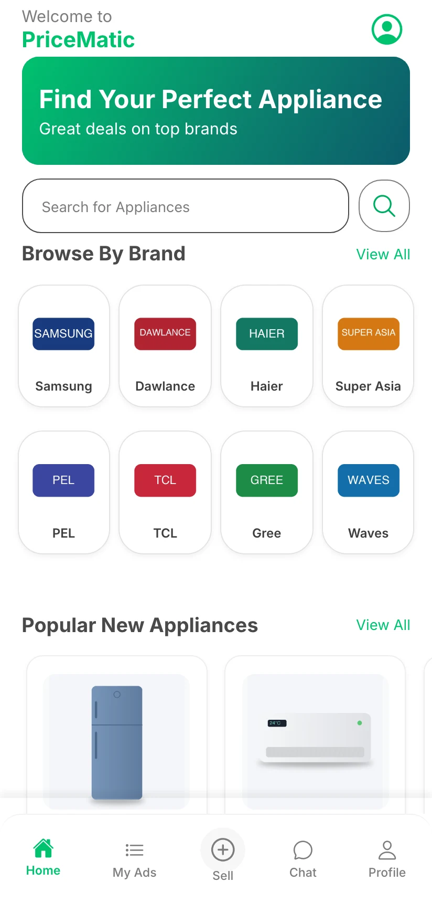
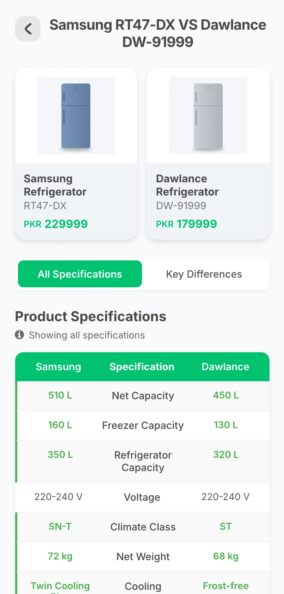
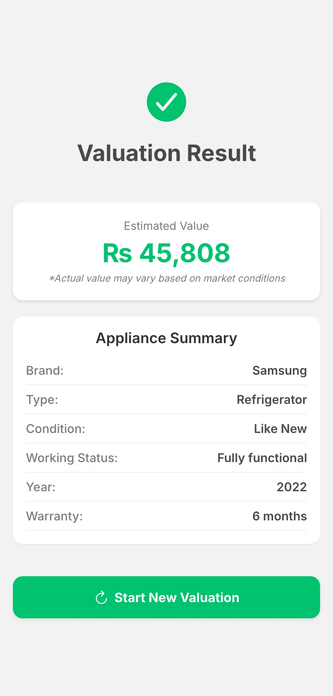
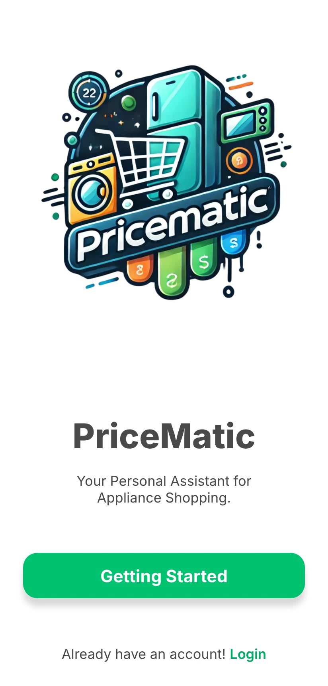
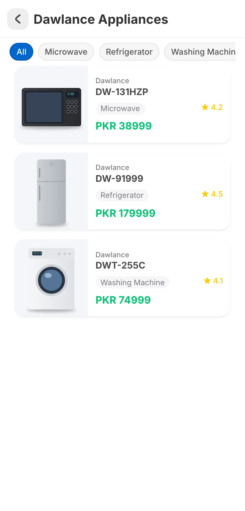
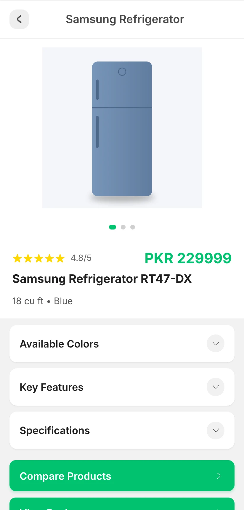
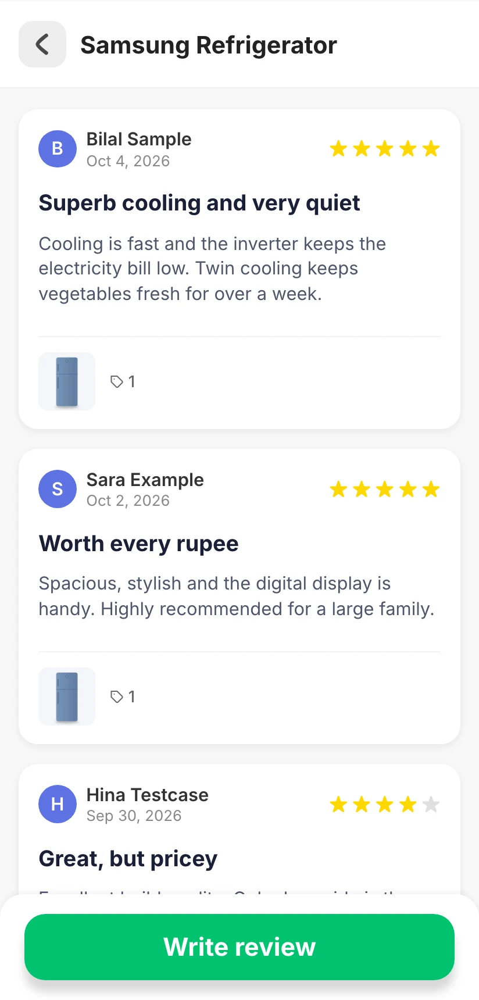
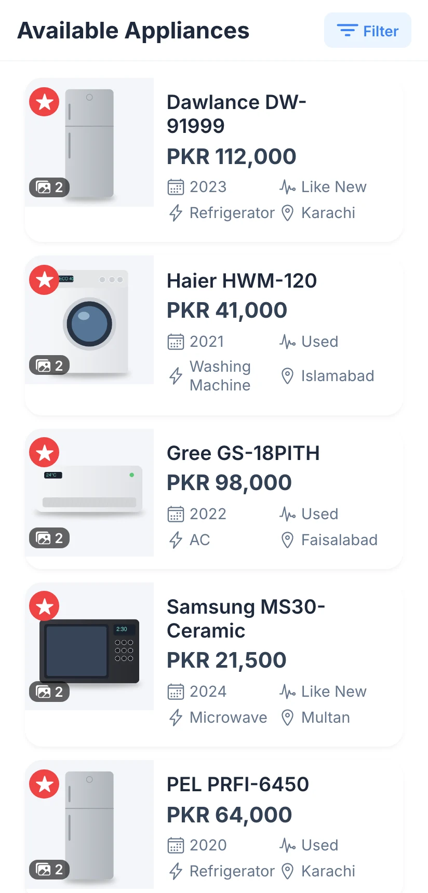
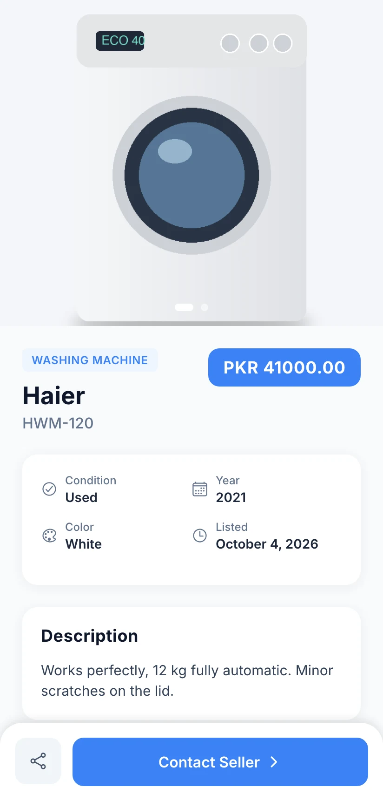
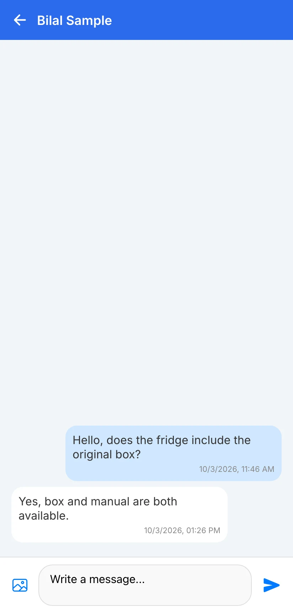

# Price-Matic

**A mobile-first appliance marketplace: browse and compare new appliances, trade used ones with seller chat, and get an ML price estimate for an old appliance.**

React Native · Expo · Supabase · FastAPI · scikit-learn

<table>
  <tr>
    <td></td>
    <td></td>
    <td></td>
  </tr>
</table>
Screenshots are real captures of a local build running on fictional demo data.

---

## Product at a Glance

| | |
|---|---|
| **What it is** | Appliance marketplace and price assistant for the Pakistani market (prices in PKR) |
| **Platform** | Mobile-first React Native / Expo app; the demo is captured from the Expo web target |
| **New appliances** | Brand catalogue, category filter, product pages with features and specifications |
| **Comparison** | Two appliances side by side, with all specs or key differences only |
| **Marketplace** | Used-appliance listings with filters, listing detail and seller chat |
| **Selling** | Listing form with photos and a "My Ads" screen with edit and delete |
| **Valuation** | Price estimate for a used appliance from a scikit-learn model served by FastAPI |
| **Reviews** | Per-appliance and global reviews, plus a write-review flow |
| **Admin** | Dashboard and inventory screens to add, edit and delete appliances |
| **Size** | 30 routes |

## Product Showcase

<table>
  <tr>
    <td align="center"> <b>Welcome</b> Entry and login</td>
    <td align="center"> <b>Brand catalogue</b> Category filter</td>
    <td align="center"> <b>Product page</b> Gallery, specs, features</td>
    <td align="center"> <b>Reviews</b> Ratings and comments</td>
  </tr>
  <tr>
    <td align="center"> <b>Marketplace</b> Used listings</td>
    <td align="center"> <b>Listing</b> Details and contact</td>
    <td align="center"> <b>Seller chat</b> Threaded messages</td>
    <td align="center"> <b>Valuation</b> ML price estimate</td>
  </tr>
</table>

## Key Features

- **Browse by brand.** A brand grid and popular-appliance carousel on the home screen, with a category filter inside each brand.
- **Product detail.** Image gallery, rating, price, and collapsible key features and specification tables.
- **Side-by-side comparison.** Pick two appliances and view all specifications or only the differences, with differing values highlighted.
- **Reviews.** Read reviews per appliance or across the catalogue and write your own.
- **Used marketplace.** Listings with condition, year, city and photos, filters, and a Contact Seller action.
- **Seller chat.** One-to-one conversations tied to a listing, with threaded messages and image support.
- **Sell and manage.** A listing form with photo upload, plus My Ads with edit and delete.
- **Valuation.** Brand, condition, appliance type, working status, purchase year and warranty go to a FastAPI endpoint that returns an estimated price.
- **Admin screens.** Appliance inventory with add, edit and delete.

## Architecture

- The Expo app uses file-based routing (expo-router) and keeps auth state in React Context.
- A service layer wraps appliance, brand, chat, selling, image and user operations against Supabase (Postgres, Auth, Storage, Realtime).
- Price estimates are requested from a separate FastAPI service that loads a serialized scikit-learn pipeline.
- Spec data lives in type-specific tables (refrigerator, washing machine, AC) so comparison logic can rely on the right fields.

Details: [docs/ARCHITECTURE.md](docs/ARCHITECTURE.md).

## Engineering Highlights

- **Service-layer separation.** Screens call services rather than Supabase directly, which is what allowed an in-memory stand-in client to be swapped in for the demo build.
- **Per-type specification tables** instead of one generic JSON blob, with dynamic highlighting of differences in the comparison view.
- **End-to-end ML integration.** Client-side validation, a FastAPI endpoint and a scikit-learn pipeline (ordinal and one-hot encoding with linear regression) behind one screen.
- **Conversation de-duplication** per listing and user pair, so repeat enquiries reuse one thread.
- **Relational embedding** in Supabase queries to fetch reviews, users and listings together.
- **Realtime review channel** subscribed through Supabase.

More: [docs/ENGINEERING_CHALLENGES.md](docs/ENGINEERING_CHALLENGES.md) and [docs/TECHNICAL_CASE_STUDY.md](docs/TECHNICAL_CASE_STUDY.md).

## Status and Scope

- **Demo mode.** The screenshots come from a local build that uses an in-memory, fictional dataset instead of a live Supabase project. Listings, messages and reviews created in the demo are not persisted.
- **Real:** the UI, the service layer, the FastAPI endpoint and the scikit-learn model are the actual implementation, and the valuation screen calls the model end to end.
- **Demo-grade ML.** The model is trained on synthetically generated data with a hand-written price formula, so it reproduces that formula and is not market-trained.
- **Placeholder:** the "Check with AI" button on the sell screen is UI only; no other AI features are implemented.
- **Known rough edges:** the database schema file uses different column naming from the app code, and some backend dependencies are not pinned in the requirements file.
- Appliance images in the demo are generated illustrations.

## Documentation

- [Product overview](docs/PRODUCT_OVERVIEW.md)
- [Architecture](docs/ARCHITECTURE.md)
- [Technical case study](docs/TECHNICAL_CASE_STUDY.md)
- [Engineering challenges](docs/ENGINEERING_CHALLENGES.md)
- [Privacy and source](docs/PRIVACY_AND_SOURCE.md)

## Rights

See [RIGHTS.md](RIGHTS.md).
