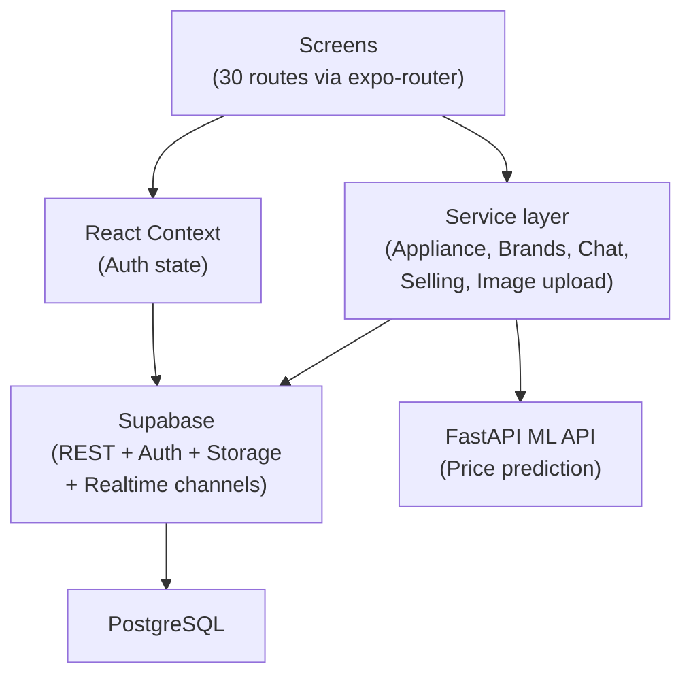

# Architecture

All diagrams are original and conceptual. They describe responsibilities, not production class or file names.

## System layers

The app's screens talk to a dedicated service layer, which abstracts Supabase database and auth operations and calls an external ML API for price estimates. Auth state flows through React Context.

## Data model

Core entities:

- **Appliances:** new products with brand, category, detailed specs (stored in type-specific tables: fridge_specs, washing_machine_specs, ac_specs), features, and a photo gallery.
- **Listings:** second-hand appliances with seller, condition, price, photos, and timestamps.
- **Reviews:** community feedback on appliances (rating, text, images, reviewer name).
- **Chat:** seller-to-buyer one-to-one conversations tied to listings, with threaded messages and image support.
- **Users:** authenticated via Supabase Auth (email and password), with profile data.

Relationships connect reviews to appliances and users, listings to users (seller), chat to listings, and messages to users and conversations.

## ML pipeline

A scikit-learn pipeline (OrdinalEncoder → OneHotEncoder → LinearRegression) predicts second-hand appliance prices from six inputs: brand, condition, appliance type, working status, year, and warranty status. The model is serialized to `backend/ml/model.pkl` and served via a FastAPI `/api/predict` endpoint. Predictions flow end-to-end from the mobile app's Valuation screen through the service layer.

Training uses synthetically generated data based on a hand-written price formula, so the model learns that formula and is presented as a demo-grade estimator suitable for showing capability, not as market-trained prediction.

## Image handling

Appliance and listing photos upload to Supabase Storage; the image service manages local URLs in demo mode (via a small local asset server) and cloud URLs in production.

## Real-time features

The app uses a Supabase Realtime channel for reviews. Chat conversations are de-duplicated per (listing, user pair) so the same buyer and seller do not end up with multiple threads for one listing.
